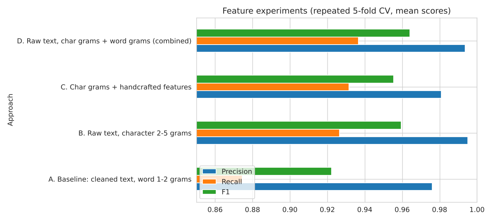
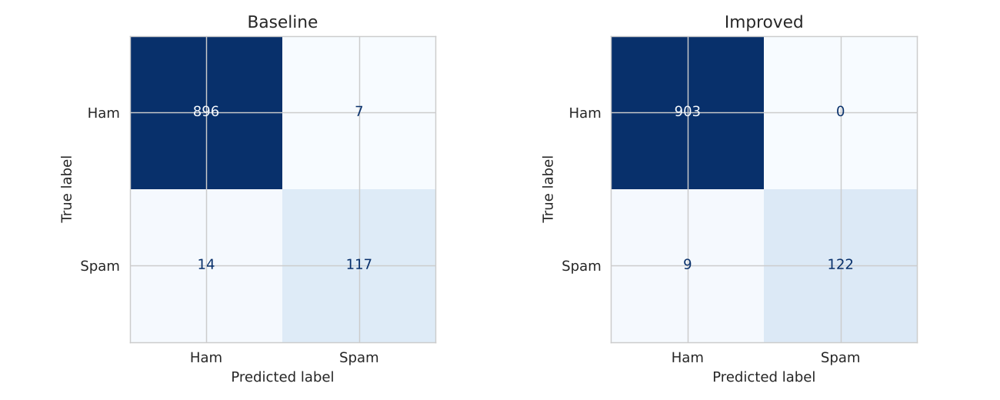
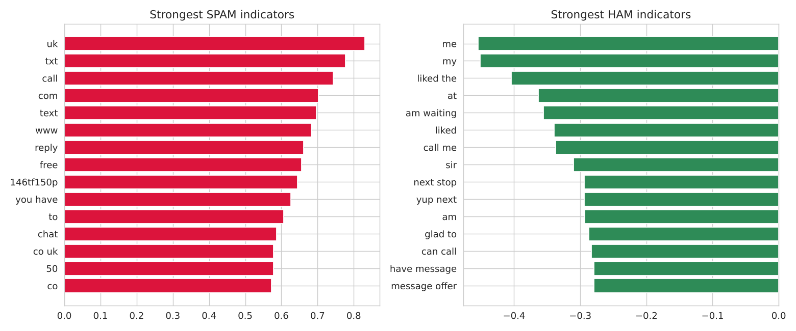

# 📱 SMS Spam Detection using SVM

[](https://colab.research.google.com/github/afia-tasnia/sms-spam-detection-svm/blob/main/SMS_Spam_SVM_final.ipynb)

Classifies SMS messages as **spam** or **ham** (normal) using TF-IDF features and a **Linear Support Vector Machine**.
Started from a lab notebook (baseline SVM) and extended with better features, deeper evaluation, model explanation and a small demo app.

## 🔑 Key results

Dataset: [SMS Spam Collection](https://www.kaggle.com/datasets/uciml/sms-spam-collection-dataset) - 5,572 messages, 5,169 after removing 403 duplicates (12.6% spam).

**Feature experiments** - repeated 5-fold cross-validation (5 folds x 3 repeats), mean scores on the spam class:

| Approach | Accuracy | Precision | Recall | F1 |
|---|---|---|---|---|
| A. Baseline: cleaned text, word 1-2 grams | 0.9814 | 0.9761 | 0.8744 | 0.9223 |
| B. Raw text, character 2-5 grams | 0.9901 | 0.9952 | 0.9265 | 0.9594 |
| C. Char grams + handcrafted features (length, digits, caps...) | 0.9890 | 0.9808 | 0.9316 | 0.9554 |
| **D. Raw text, char + word grams (final model)** | **0.9912** | 0.9936 | **0.9367** | **0.9642** |

**Held-out test set** (1,034 messages, 131 spam; split 80/20, `random_state=42`):

| Model | Accuracy | Precision | Recall | F1 |
|---|---|---|---|---|
| Baseline SVM (tuned) | 0.9797 | 0.9435 | 0.8931 | 0.9176 |
| **Improved SVM (char + word)** | **0.9913** | **1.0000** | **0.9313** | **0.9644** |

> Note: the test set has only 131 spam messages, so single-split numbers are noisy (1 message ~ 0.8% recall). The cross-validation table is the stronger evidence. Idea C (handcrafted features) did **not** improve over B/D and was dropped.




## 🧠 What was done

| Step | Details |
|---|---|
| Data checks | label balance, 403 duplicates removed **before** splitting (avoids test leakage) |
| EDA | class balance, message length, word clouds |
| Preprocessing (baseline) | lowercase, remove URLs/emails/numbers/punctuation, stopwords, lemmatization |
| Models compared | Naive Bayes, Logistic Regression, **Linear SVM** (best recall/F1) |
| Tuning | `GridSearchCV` over `C`, 5-fold CV, scored on **F1** (data is imbalanced) |
| Evaluation | confusion matrix, ROC, Precision-Recall curve, repeated CV |
| **Improvement** | TF-IDF on **raw text** with **character + word n-grams** (keeps signals like `£`, `150p`, `txt`, capitals) |
| Threshold analysis | precision/recall trade-off chosen from cross-validated train scores only |
| Explainability | most spam-/ham-indicating words from SVM weights |
| Error analysis | reads misclassified original messages |
| Deployment | saved model (`joblib`), `predict_sms()` with confidence score, Streamlit demo |



## 🚀 How to run

**Option 1 - Google Colab (easiest):** click the Colab badge above, then *Runtime -> Run all*. The dataset downloads automatically.

**Option 2 - locally:**
```bash
git clone https://github.com/afia-tasnia/sms-spam-detection-svm.git
cd sms-spam-detection-svm
pip install -r requirements.txt
jupyter notebook SMS_Spam_SVM_final.ipynb      # then Run all
```
If the automatic download fails, download `spam.csv` from [Kaggle](https://www.kaggle.com/datasets/uciml/sms-spam-collection-dataset) and place it next to the notebook.

**Demo app:**
```bash
pip install streamlit
streamlit run app.py
```

## 📁 Repository structure
```
├── SMS_Spam_SVM_final.ipynb   # full notebook with outputs
├── app.py                     # Streamlit demo
├── models/sms_spam_svm_model.pkl   # trained pipeline (TF-IDF + SVM)
├── images/                    # figures + result tables (generated by the notebook)
├── requirements.txt
└── README.md
```

## ⚠️ Limitations
* Small, old (~2005) dataset of mostly British/Singaporean English SMS - modern spam looks different.
* Bag-of-words ignores meaning; most remaining misses are short promo-style texts (e.g. ringtone codes, "missed call" alerts).
* The saved `.pkl` is tied to the scikit-learn version used to train it; re-run the notebook if loading fails.
* Possible next steps: transformer model (DistilBERT), calibrated probabilities, more recent data.

## 📚 Dataset
UCI SMS Spam Collection (Almeida & Hidalgo). Used for educational purposes.
